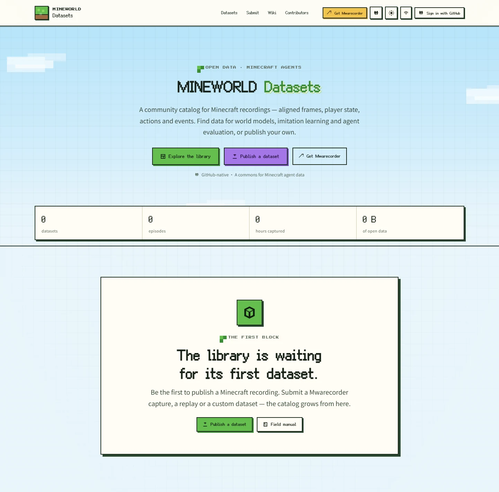

# MineWorld Datasets

A GitHub-native catalog for community-recorded **Minecraft agent datasets** — video, player state, actions, events, replays, raw footage and custom tensor packs.

The site is an Astro static build. Submissions are GitHub Issue Forms that become validated JSON pull requests. Likes are real GitHub reactions, comments use Giscus, corrections become pull requests, and moderation happens against the repository's own permissions.

> Looking for the recorder? **[Mwarecorder →](https://github.com/Kurisa-kuku/MineWorld-Agent-Recorder)**. It is optional; this catalog accepts any documented format.



---

## What is inside

- **Bilingual catalog** at `/en/…` and `/zh/…` with browser-language routing, human-readable fallbacks, and `Intl` dates/numbers.
- **URL-synced library** with 13 filter dimensions, search, five sort modes, active-filter chips and shareable views.
- **Dataset detail pages** with compatibility, scale, controlled tags, access and privacy disclosures, usage notes, changelog, deprecation/replacement banners, GitHub reactions and Giscus comments.
- **Issue Form → JSON → pull request** automation: cover download, 16:9 WebP conversion, thumbnail generation, schema validation, idempotent PR updates.
- **Metadata editor** for anyone with a GitHub account. It creates a correction issue; automation validates it and opens a PR. No repository write access is required.
- **Maintainer control room** with reports, corrections, link-health and PR queues, plus comments, close and merge actions. GitHub write permission is the real gate.
- **Scheduled link health** and **community reaction snapshots**.
- **Pixel/Minecraft design system** with day/night CSS variables, hard 2px borders, hard shadows, 9-slice-style panels, pixel icons, and reduced-motion fallbacks.
- **Wiki** with submission, data contract, correction, moderation and FAQ pages in both languages.

The catalog launches empty. The first merged submission creates the first listing.

## Stack

| Layer | Choice |
| --- | --- |
| Framework | Astro 5 (static output) |
| Language | TypeScript |
| i18n | i18next (server + browser) |
| Images | sharp in automation; committed WebP + thumbnail |
| Data validation | JSON Schema + Ajv |
| Auth | GitHub browser device flow via optional secretless proxy, or a session-only PAT fallback |
| Comments | Giscus / GitHub Discussions |
| Likes | GitHub issue reactions, snapshotted by workflow |
| Hosting | GitHub Pages / GitHub Actions |

## Local quick start

```bash
pnpm install
cp .env.example .env
pnpm dev
```

Open the URL printed by Astro. Useful commands:

```bash
pnpm validate:data   # schema, tag vocabulary, cover dimensions, references
pnpm check           # Astro + TypeScript diagnostics
pnpm build           # validate + check + static build
pnpm preview         # preview dist/
pnpm art             # regenerate seed pixel art (Python + Pillow)
```

Requirements: Node.js 22+, pnpm 11+.

## Repository layout

```text
.
├─ data/
│  ├─ datasets/*.json          one listing per file
│  ├─ tags.json                bilingual controlled vocabulary
│  └─ community/stats.json     generated reaction/comment snapshot
├─ schemas/dataset.schema.json authoritative JSON Schema
├─ public/
│  ├─ covers/                  WebP covers + thumbnails
│  └─ og.png / favicon.svg     social preview and icon
├─ src/
│  ├─ pages/[lang]/            all localized routes
│  ├─ components/              layout, filters, cards, auth, Giscus, hero
│  ├─ scripts/                 library, editor, admin, auth, likes
│  ├─ i18n/                    i18next resources and helpers
│  └─ lib/                     typed data layer and formatting
├─ docs/en|zh/                 Markdown wiki
├─ scripts/                    automation and validation CLIs
└─ .github/
   ├─ ISSUE_TEMPLATE/          submission, correction and report forms
   └─ workflows/               deploy, validate, issue-to-pr, link health, stats
```

## How publishing works

1. A contributor opens **Submit** → the dataset Issue Form on GitHub.
2. `issue-to-pr.yml` parses the rendered Form markdown.
3. The script converts a dragged cover to WebP (1280×720 + 640×360), validates JSON against the schema and tag vocabulary, commits to a branch, and opens/updates a PR.
4. A maintainer reviews license, privacy, links and data scale, then merges.
5. `deploy.yml` rebuilds GitHub Pages. `community-sync.yml` creates a reactions issue and snapshots counts.

Corrections work the same way through `/en/edit/` or `/zh/edit/`: the editor creates an issue with a machine-readable JSON block, automation opens the correction PR, preserving slug, cover, contributors, submission metadata and appending a changelog entry.

The automation **never** merges and **never** writes to `main` directly.

## Configuration

Edit `.env` for local work or repository Variables for deployments. The documented variables are listed in [`.env.example`](.env.example), and the GitHub setup checklist is below.

Key values:

- `PUBLIC_REPO_SLUG` — owner/repo that stores site + data
- `PUBLIC_RECORDER_REPO` — repository behind the **Get Mwarecorder** button
- `PUBLIC_GITHUB_OAUTH_CLIENT_ID` — optional, enables browser device-flow login
- `PUBLIC_GITHUB_AUTH_BASE` — optional device-flow proxy (see [`workers/oauth-proxy`](workers/oauth-proxy/README.md))
- `PUBLIC_GISCUS_*` — optional, enables embedded comments
- `SITE_URL`, `BASE_PATH` — set automatically by the deploy workflow

The default repository slug is `Kurisa-kuku/MINEWORLD-Datasets-site`. If you fork or rename, update `.env.example`, `src/config.ts` defaults, docs links and the issue-template `config.yml` contact links.

### GitHub setup checklist

1. Create a public repository and push this folder.
2. **Settings → Pages → Source: GitHub Actions.**
3. **Settings → Actions → General → Workflow permissions:** allow read/write; enable *Allow GitHub Actions to create and approve pull requests*.
4. Run **Actions → Sync repository labels → Run workflow**.
5. Optionally create the GitHub OAuth App, enable device flow, deploy [`workers/oauth-proxy`](workers/oauth-proxy/README.md), and set `PUBLIC_GITHUB_OAUTH_CLIENT_ID` + `PUBLIC_GITHUB_AUTH_BASE`.
6. Optionally enable Discussions + Giscus and set the three `PUBLIC_GISCUS_*` values.

## Access control notes

- The admin page is public and read-only until a GitHub token with repository push access is present.
- The browser keeps tokens in `sessionStorage`; this project has no auth server. It is designed for a community moderation tool, not for organisation-wide secrets.
- Device flow requires a public OAuth client id, never a client secret.
- Giscus and GitHub reactions are public by design.

## License

The site code and catalog metadata are **MIT** licensed; see [LICENSE](LICENSE). Each dataset retains its own license. Third-party component credits are in [THIRD_PARTY_NOTICES.md](THIRD_PARTY_NOTICES.md). Minecraft is a trademark of Mojang/Microsoft; this project is not affiliated with Mojang.

Default pixel-art covers and the social preview artwork in `public/` were generated for this project. Review the rights of any community cover before publishing it.
